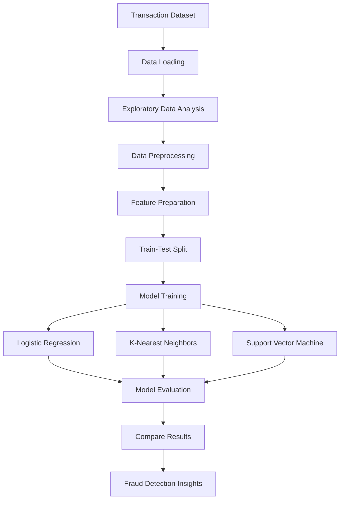

# Credit Card Fraud Detection Using Machine Learning

A machine learning project focused on identifying potentially fraudulent credit card transactions using supervised learning algorithms. The project explores data preprocessing, model training, classification, and evaluation to understand how machine learning can help detect suspicious financial activity.

**Author:** Ayush Srivastav

---

## Table of Contents

- [Overview](#overview)
- [Problem Statement](#problem-statement)
- [Objectives](#objectives)
- [Machine Learning Models](#machine-learning-models)
- [Technology Stack](#technology-stack)
- [System Architecture](#system-architecture)
- [Project Structure](#project-structure)
- [Workflow](#workflow)
- [Installation and Setup](#installation-and-setup)
- [Running the Project](#running-the-project)
- [Model Evaluation](#model-evaluation)
- [Key Learnings](#key-learnings)
- [Future Improvements](#future-improvements)
- [Limitations](#limitations)
- [Author](#author)
- [License](#license)

---

## Overview

Credit card fraud is a significant challenge in the financial industry. Machine learning can help identify suspicious transaction patterns by learning from historical transaction data.

This project explores multiple classification algorithms to distinguish between legitimate and potentially fraudulent transactions. It demonstrates the application of machine learning techniques to a real-world financial problem.

The project includes Jupyter notebooks and accompanying reports covering different machine learning models, including:

- K-Nearest Neighbors (KNN)
- Logistic Regression
- Support Vector Machines (SVM)

The objective is to understand, implement, and compare these approaches for a fraud detection task.

## Problem Statement

The goal is to develop machine learning models that classify credit card transactions into two categories:

- **Legitimate transaction:** A transaction labeled as non-fraudulent.
- **Fraudulent transaction:** A transaction labeled as fraudulent.

Fraud detection is particularly challenging because fraudulent transactions may represent only a small fraction of the dataset. Consequently, accuracy alone may not adequately describe a model's performance.

A useful model should identify fraudulent transactions while controlling false alarms on legitimate transactions.

## Objectives

- Understand and explore transaction data.
- Perform data preprocessing and prepare features for training.
- Implement supervised machine learning classification algorithms.
- Evaluate model performance using appropriate classification metrics.
- Understand the challenges associated with imbalanced datasets.
- Compare different approaches to credit card fraud detection.
- Explore how machine learning can support financial risk monitoring.

## Machine Learning Models

### 1. Logistic Regression

Logistic Regression is a supervised classification algorithm that estimates the probability of a transaction belonging to a particular class.

**Why use it?**

- Provides a useful baseline for binary classification.
- Can estimate class probabilities.
- Offers relatively interpretable model coefficients.

### 2. K-Nearest Neighbors (KNN)

KNN classifies a transaction based on the labels of nearby samples in the feature space.

**Why use it?**

- Provides a distance-based classification approach.
- Helps explore relationships between similar transactions.
- Demonstrates the importance of feature scaling and distance metrics.

### 3. Support Vector Machine (SVM)

SVM attempts to find a decision boundary that separates different classes. Kernel functions can also model nonlinear boundaries.

**Why use it?**

- Can work effectively with high-dimensional feature spaces.
- Supports linear and nonlinear classification.
- Provides an alternative approach for comparing classification performance.

The best-performing model should be determined using measured results on an appropriate validation or test dataset rather than assumed in advance.

## Technology Stack

| Technology | Purpose |
|---|---|
| Python | Core programming language |
| Jupyter Notebook | Interactive experimentation and analysis |
| Pandas | Data manipulation and preprocessing |
| NumPy | Numerical operations |
| Scikit-learn | Machine learning algorithms and evaluation |
| Matplotlib | Data visualization |
| Seaborn | Statistical data visualization |
| Git | Version control |
| GitHub | Source code hosting and project documentation |

The listed libraries describe the intended machine learning workflow. Confirm the imports in the notebooks before treating every library as an installed dependency.

## System Architecture

The project follows a typical offline machine learning workflow.



### Architecture Components

1. **Data source:** Supplies historical transaction records and their corresponding labels.
2. **Data preprocessing:** Handles missing values, data types, feature preparation, and any required scaling.
3. **Feature preparation:** Selects the input features and target variable.
4. **Model training:** Trains the selected classification algorithms using training data.
5. **Model evaluation:** Measures performance using suitable classification metrics.
6. **Result comparison:** Compares model behavior and identifies potential improvements.

This diagram represents the analytical workflow; it does not imply that a deployed real-time prediction API or web application is included.

## Project Structure

The repository contains a project folder named `Credit Card Fraud Detection Using Machine Learning`, which holds the notebooks and reports.

A logical representation of the project is shown below. The exact filenames may vary from the current repository.

```text
Credit_Card_Fraud_Detection/
│
├── Credit Card Fraud Detection Using Machine Learning/
│   ├── Credit Card Fraud Detection Using Machine Learning/
│   │   ├── Credit Card Fraud Detection - K-Nearest Neighbor - Jupyter Notebook.pdf
│   │   ├── Credit Card Fraud Detection - Logistic Regression - Jupyter Notebook.pdf
│   │   └── Credit Card Fraud Detection - Support Vector Machines - Jupyter Notebook.pdf
│   │
│   ├── Credit Card Fraud Detection Using Machine Learning.pdf
│   │
│   └── [Jupyter notebooks and other project files, if present]
│
├── .gitignore
├── .gitattributes
└── README.md
```

Update this structure to match the actual files in your repository. Add a `requirements.txt`, dataset folder, or saved model only if those files are present or you create them.

## Workflow

### Step 1: Data Loading

Load the transaction dataset into a Pandas DataFrame and inspect its dimensions, column names, data types, and target labels.

### Step 2: Exploratory Data Analysis

Explore the distribution of transaction classes, examine feature distributions, and identify possible data quality issues.

### Step 3: Data Preprocessing

Prepare the features and target variable. Apply appropriate scaling where needed, especially for distance-based methods such as KNN and margin-based methods such as SVM.

### Step 4: Dataset Splitting

Separate the data into training and test sets. For imbalanced classification, a stratified split can help preserve the class distribution.

Preprocessing transformations should be fitted using training data only to reduce data leakage.

### Step 5: Model Training

Train Logistic Regression, KNN, and SVM models using the training dataset.

### Step 6: Model Evaluation

Evaluate predictions on unseen test data using metrics such as precision, recall, F1-score, and the confusion matrix.

### Step 7: Model Comparison

Compare the models and consider the trade-off between detecting fraudulent transactions and incorrectly flagging legitimate transactions.

## Model Evaluation

Fraud detection is typically an imbalanced binary classification problem. The following metrics are useful for assessing performance.

| Metric | Meaning |
|---|---|
| Accuracy | Fraction of all predictions that are correct |
| Precision | Fraction of predicted fraud cases that are actually fraudulent |
| Recall | Fraction of actual fraud cases correctly identified |
| F1-score | Harmonic mean of precision and recall |
| Confusion matrix | Counts true positives, true negatives, false positives, and false negatives |
| ROC-AUC | Measures discrimination across classification thresholds |
| PR-AUC | Summarizes the precision-recall trade-off across thresholds |

In fraud detection, **recall and precision are especially important**. Low recall means fraudulent transactions are being missed, while low precision means more legitimate transactions are incorrectly flagged.

The choice of operating threshold should reflect the relative costs of missed fraud and false alarms.

Actual metric values should be reported only after running the models and evaluating them on held-out data.

## Key Learnings

This project provides an opportunity to develop practical knowledge of:

- Supervised machine learning and binary classification.
- Exploratory data analysis and data preprocessing.
- Feature scaling and train-test splitting.
- Logistic Regression, KNN, and SVM.
- Classification metrics and confusion matrices.
- Class imbalance and the limitations of accuracy.
- Comparing machine learning algorithms.
- Reproducible experimentation using Jupyter Notebook.

## Future Improvements

Potential extensions to this project include:

- Investigating class imbalance with class weighting or carefully applied resampling methods.
- Comparing additional models, such as Random Forest and gradient boosting.
- Using cross-validation and systematic hyperparameter tuning.
- Improving model interpretability with feature importance or SHAP.
- Creating a prediction API using FastAPI or Flask.
- Developing a web interface for transaction analysis.
- Deploying a model with appropriate monitoring and versioning.
- Monitoring changes in transaction patterns and model performance over time.

These are possible future enhancements and are not necessarily implemented in the current repository.

## Limitations

- Model performance depends on the quality, representativeness, and availability of transaction data.
- Results from historical data may not generalize to future fraud patterns.
- Class imbalance can make accuracy misleading.
- Offline experiments do not establish production readiness.
- A practical fraud detection system would require additional considerations, including privacy, security, latency, monitoring, and human review.

## Author

**Ayush Srivastav**

GitHub: [@AyushSrivastav833](https://github.com/AyushSrivastav833)

Project Repository: [Credit Card Fraud Detection](https://github.com/AyushSrivastav833/Credit_Card_Fraud_Detection)

---

If you find this project useful, consider giving the repository a star.

**Disclaimer:** This project is intended for educational and experimental purposes. It should not be used as the sole basis for real-world financial decisions or fraud investigations.
